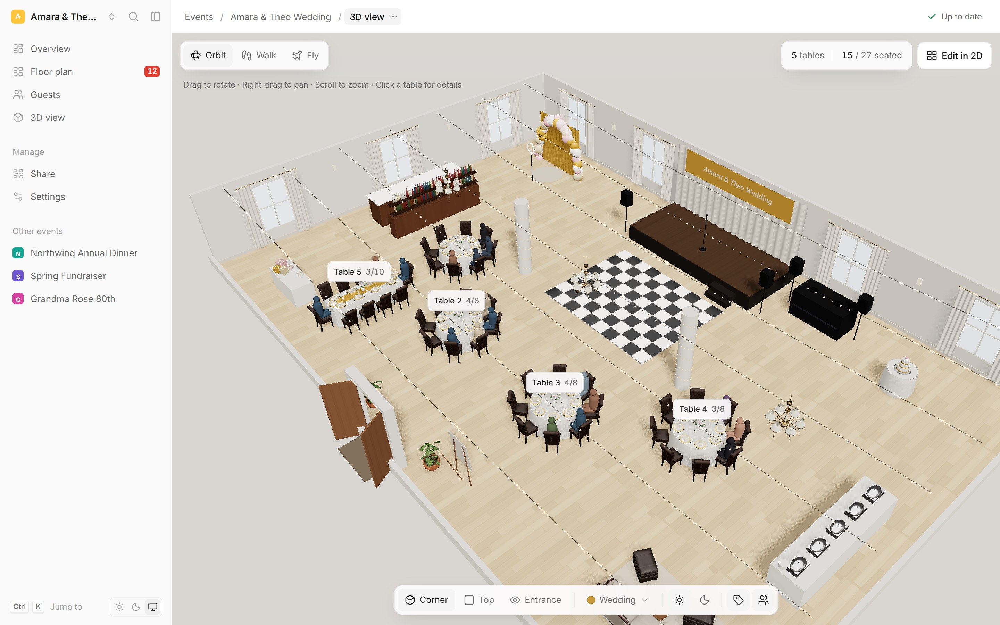
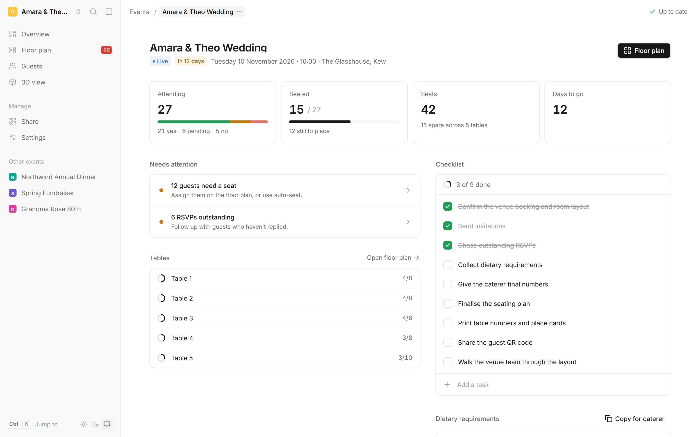
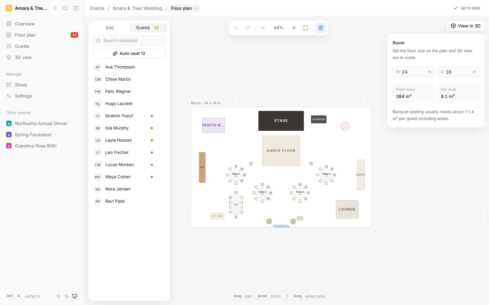
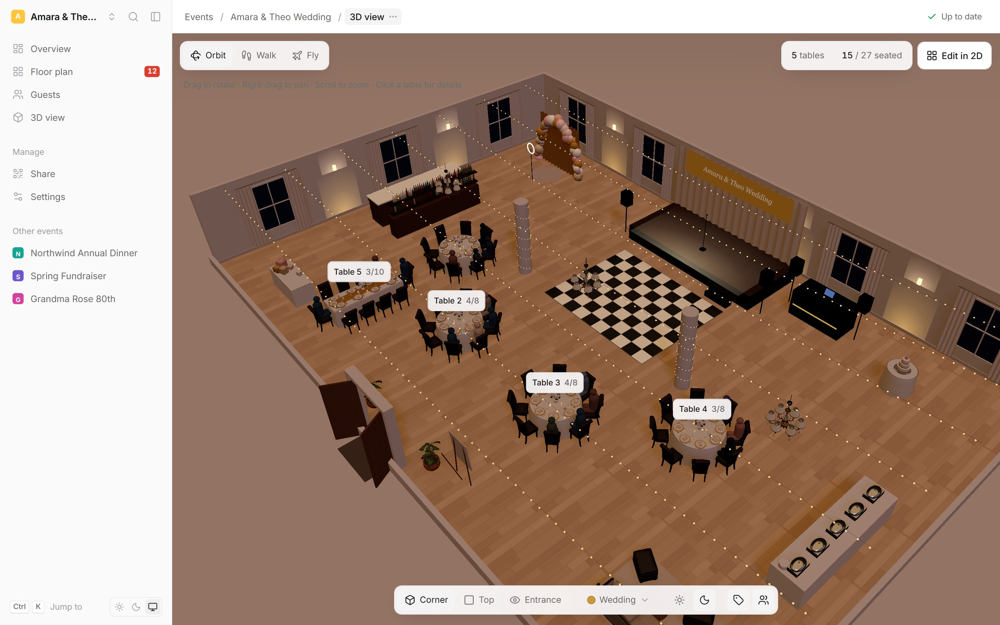
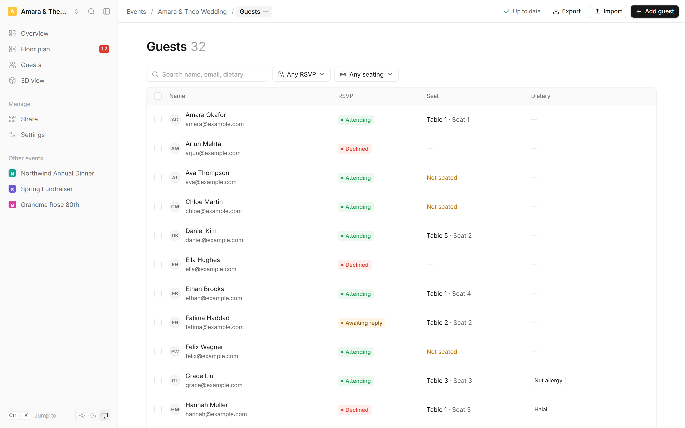
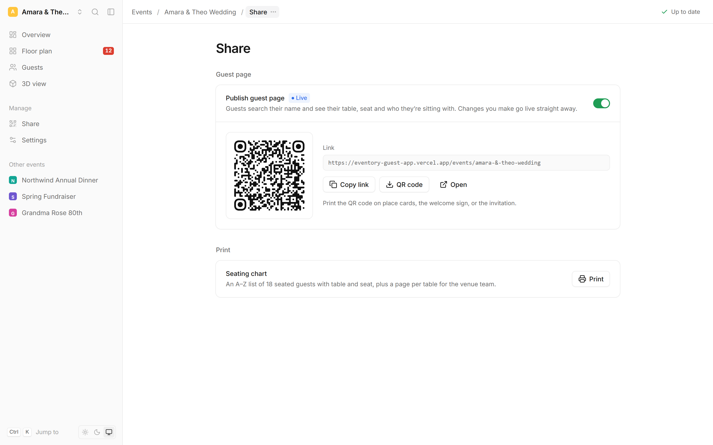
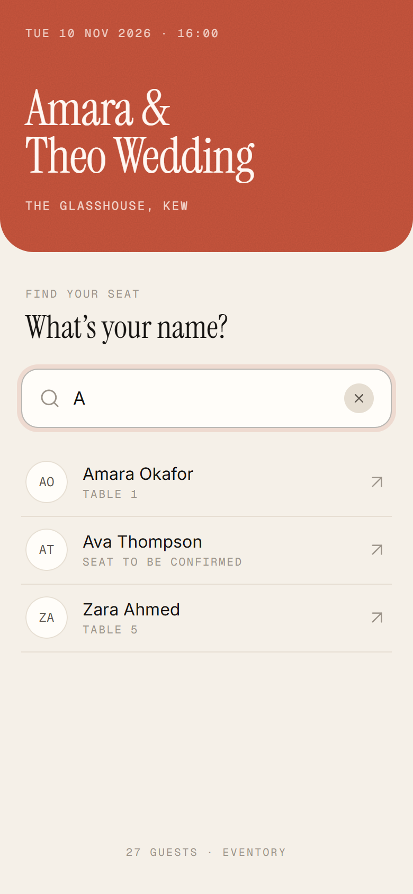
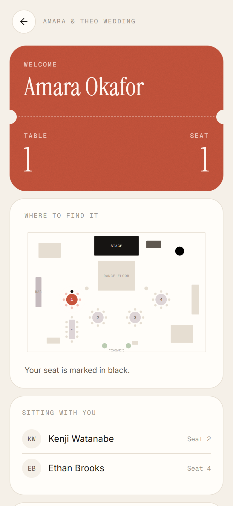
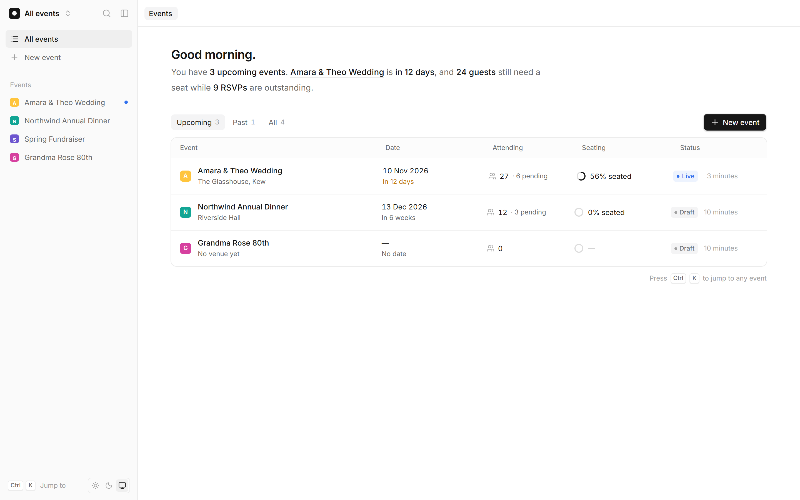
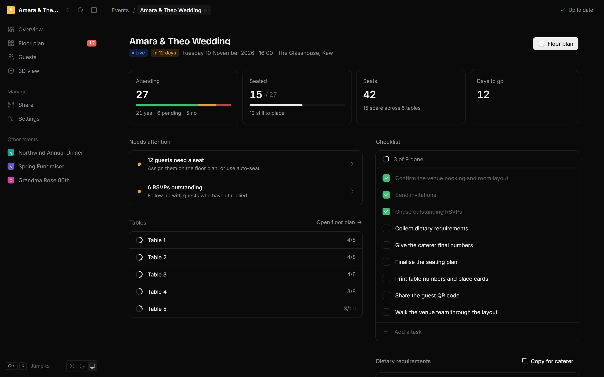

<div align="center">

# Eventory

**Plan the room, seat your guests, and let everyone find their table from their phone.**

A seating planner for weddings, dinners and parties: a 2D floor plan editor, a live 3D walkthrough of the room, and a mobile page guests open from a QR code.




</div>

## The problem

Anyone who has planned a seated event knows the routine: a spreadsheet of names, a separate sheet of RSVPs, sticky notes on a printed floor plan, and a group chat full of "who's sitting where?" On the day, guests crowd around one seating board at the door.

The pieces never stay in sync. Someone declines, a table moves, a dietary requirement gets lost between the guest list and the caterer. And until the doors open, nobody can really picture how the room will feel.

## What Eventory does

Eventory puts the guest list, the room and the seating plan in one place, and keeps them in sync.

- **Planners** lay out the venue to scale, drag guests onto seats (or auto-seat everyone), and track RSVPs and dietary needs as they go.
- **The room** can be explored in 3D before the day: tables, chairs, stage, bar and decor, all generated from the same plan.
- **Guests** scan a QR code, type their name, and see their table, their seat, who they're sitting with, and where to find it on a map.

## Features

### Overview at a glance
A summary of each event: who's coming, how many are seated, seats to spare, and a checklist. A **Needs attention** list flags what's left to do and links straight to the fix.



### Floor plan editor
- Drag tables, chairs, stage, bar, dance floor and more onto a room drawn **to real-world scale** (metres, with floor area per guest).
- Drag guests from the unseated list onto a seat, or press **Auto-seat** to fill the tables.
- Alignment guides, snap-to-grid, marquee select, rotate, duplicate, and full **undo/redo**.
- Hide individual seats, for example where two tables meet.
- Everything **autosaves** in the background.



### 3D walkthrough
The floor plan becomes a furnished 3D room you can explore three ways: **Orbit** from above, **Walk** at eye level, or **Fly** through the space. Click a table to see who's sitting there.

- Decor styles (Wedding, Birthday, Family party, Corporate, Minimal) with an accent colour set place settings, centrepieces, lighting and signage.
- Day and evening lighting, guest figures in their seats, and table labels.
- Runs at **60 fps at 4K on integrated graphics** (details in [Engineering highlights](#engineering-highlights)).



### Guest list
- Search by name, email or dietary need, and filter by RSVP or seating status (filters live in the URL, so a filtered view can be shared).
- Change RSVPs inline, select several guests for bulk actions, and record dietary tags.
- **Import from Excel or CSV** with automatic column detection, and **export a CSV** sorted by table for the venue team.



### Share and print
Publish the guest page with one switch, then copy the link or download a QR code for invitations, place cards or a welcome sign. A printable seating chart (A to Z list plus a page per table) covers the venue staff and check-in desk.



### Find your seat (guest app)
A mobile page designed to be opened standing in a doorway: search-first, large type, and only what a guest needs.

<table>
  <tr>
    <td width="50%"></td>
    <td width="50%"></td>
  </tr>
  <tr>
    <td align="center"><sub>Type the first letters of your name</sub></td>
    <td align="center"><sub>Your table and seat, a map of the room, and your tablemates</sub></td>
  </tr>
</table>

### Also included
- **Dashboard** that turns your upcoming events into one readable sentence ("Amara & Theo Wedding is in 12 days, and 24 guests still need a seat...").
- **Command menu** (`Ctrl/⌘ K`) to jump to any event or page.
- **Light and dark themes**, with motion that respects the OS reduced-motion setting.
- **Copy for caterer**: dietary requirements grouped and ready to paste.

<details>
<summary><b>More screenshots</b></summary>




</details>

## Engineering highlights

A few decisions worth calling out. Each one has a longer write-up in [`DECISIONS.md`](DECISIONS.md).

- **One source of truth.** The open event (tables, guests, venue) lives in a single Zustand store with Zundo undo history. The 2D editor and the 3D view both render from it, so they can't drift apart. An earlier version kept three separately cached stores that went out of sync, and this replaced them.
- **Shared geometry.** Seat positions, table sizes and chair angles are computed in one module (`shared/src/domain/geometry.ts`) used by the planner, the 3D view and the guest app's mini map, so all three always agree.
- **A smooth canvas.** The floor plan uses react-konva. Drags run inside Konva and commit to the store once, on release, rather than re-rendering React on every pointer move. Tables are cached as bitmaps and hit-testing pauses while panning.
- **3D performance, measured.** On a Ryzen 5 laptop iGPU at a 4K-class resolution, the first version ran at about **14 fps**. Profiling showed it was fill-rate bound, so lighting, shadows and anti-aliasing were reworked without lowering visible quality. GPU time is now **8.6 ms median per frame (60 fps)**. Every chair in the room renders in a single instanced draw call, using a CC0 model simplified from 22k to 2.6k triangles.
- **Privacy by default.** Public guest endpoints return only name, seat and table. Emails and notes never leave the planner.
- **No risky migrations.** New features (venue layout, decor, checklist, event details) are stored in an existing JSON column, so the live database and guest app kept working throughout the rebuild.

## Tech stack

| Area | Tools |
| --- | --- |
| Planner app | React 19, TypeScript, Vite, Tailwind CSS 4, React Router, TanStack Query, Zustand + Zundo, Motion |
| Floor plan | Konva / react-konva |
| 3D view | Three.js, React Three Fiber, drei |
| UI primitives | shadcn/ui on Base UI, lucide icons |
| Guest app | React, Vite, Tailwind CSS |
| API | Express 5, Prisma 7, PostgreSQL (hosted on Render) |
| Tooling | pnpm workspaces, ESLint with React Compiler rules, tsup |

## Project structure

```
apps/
  planner-app/   the planner: dashboard, floor plan, guests, 3D view, share, settings
  guest-app/     the mobile page guests open from the QR code
  server/        Express API over Prisma/Postgres
packages/
  database/      Prisma schema and client
shared/          UI primitives and seat geometry used by both apps
```

Inside the planner, `domain/` holds pure TypeScript (types, geometry, stats, auto-seat), `store/` holds the workspace store and autosave, and `features/` has one folder per screen.

## Running it locally

You'll need Node 20+ and [pnpm](https://pnpm.io).

```sh
pnpm install

# An in-memory API with a sample wedding, so no database is needed
node scripts/mock-api.mjs

# In separate terminals
VITE_API_URL=http://localhost:3010 pnpm planner-app dev   # http://localhost:5173
VITE_API_URL=http://localhost:3010 pnpm guest-app dev
```

To run against a real database instead, set `DATABASE_URL` in `apps/server/.env` and start the API with `pnpm server dev`.

Other useful commands:

```sh
pnpm lint                 # ESLint for the planner, guest app and shared code
pnpm planner-app build    # type-check and production build
```

## Docs

- [`DECISIONS.md`](DECISIONS.md): why things are built the way they are
- [`docs/DESIGN.md`](docs/DESIGN.md): visual language, tokens and motion rules
- [`docs/RESEARCH.md`](docs/RESEARCH.md): the planning tools and sources behind each feature

## Credits

3D chair, plant, chandelier and furniture models are from [Poly Haven](https://polyhaven.com) (CC0). Full list in `apps/planner-app/public/models/CREDITS.txt`.
